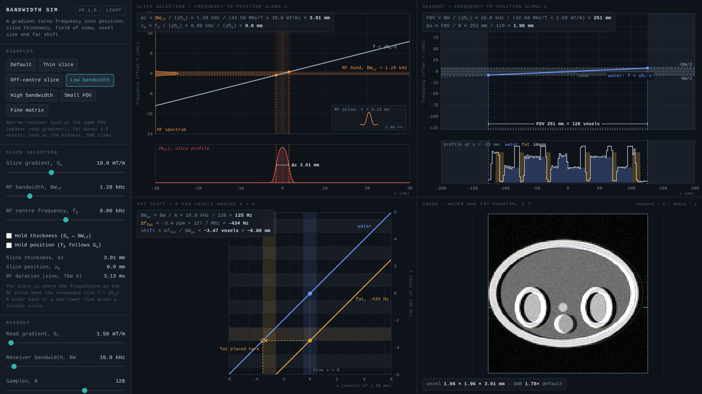
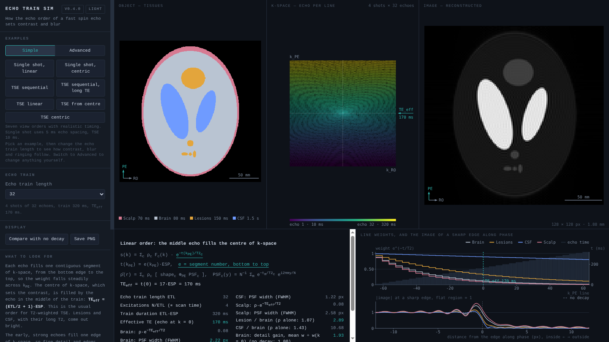
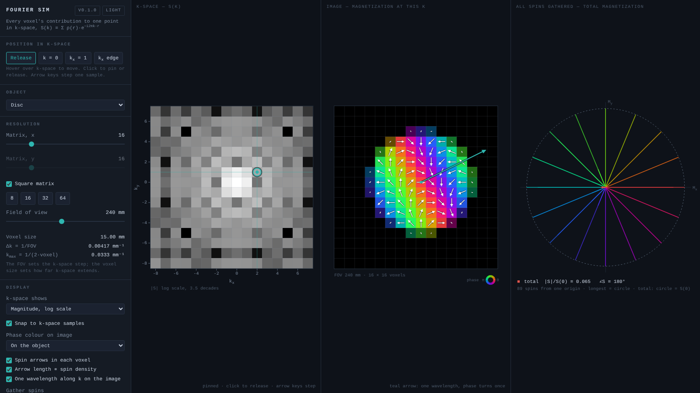

# MRI simulators for visualization
Designed by Filip Sz (Lund University) and coded by Claude (Anthropic) and ChatGPT (OpenAI).

Interactive MRI physics visualisations, each a single self-contained HTML file
that runs offline in a browser. 3D views use WebGL with Three.js bundled in the
file. They should work on PCs and phones, but phones are not tested.

**These are visual teaching aids, not quantitative simulators.** They are meant
for showing ideas and making figures and clips, not for predicting signal. The
models are deliberately simplified. Each simulator lists its simplifications,
credits and changelog under the version chip in its header.

| Simulator | Topic |
|---|---|
| [`mriRelaxSim.html`](#mrirelaxsimhtml--relaxation-sim) | T1, T2 and T2\* relaxation |
| [`mriSeqSim.html`](#mriseqsimhtml--sequence-sim) | Bloch simulation of common sequences |
| [`mriFieldSim.html`](#mrifieldsimhtml--field-sim) | Gradient and concomitant (Maxwell) fields |
| [`mriInductSim.html`](#mriinductsimhtml--induction-sim) | Signal induction in a receive coil |
| [`mriSliceSim.html`](#mrislicesimhtml--slice-sim) | Slice-selective excitation and the rewinder |
| [`mriBandwidthSim.html`](#mribandwidthsimhtml--bandwidth-sim) | Slice thickness, FOV, voxel size and fat shift from gradients and bandwidth |
| [`mriReadoutSim.html`](#mrireadoutsimhtml--readout-sim) | K-space trajectories in spin-echo imaging |
| [`mriArtifactSim.html`](#mriartifactsimhtml--artifact-sim) | Image artifacts from the signal equation |
| [`mriEchoTrainSim.html`](#mriechotrainsimhtml--echo-train-sim) | Fast spin echo view order: T2 contrast, blur and ringing |
| [`mriBTensorSim.html`](#mribtensorsimhtml--b-tensor-sim) | b-tensor glyphs from tensors or gradient waveforms |
| [`mriBuildSim.html`](#mribuildsimhtml--build-sim) | Building pulse sequences from RF, gradient and ADC blocks |
| [`mriFourierSim.html`](#mrifouriersimhtml--fourier-sim) | How every voxel contributes to one point in k-space |

## How to use

Download a simulator and open it in a local browser. Clicking an `.html` file
on GitHub only shows its source.

- **One file:** open the file on GitHub and click *Download raw file* (↓).
- **All files:** **Code → Download ZIP**, or
  `git clone https://github.com/filip-szczepankiewicz/mriSimGraphical.git`

Then double-click the file, or drag it into a browser. A recent Chrome, Edge,
Firefox or Safari is recommended. Video recording uses the WebCodecs API, which
works best in Chrome or Edge. On a phone, save the file and open it in a browser
from the file manager; some file viewers show the source instead.

## `mriRelaxSim.html` — Relaxation sim

Where T1, T2 and T2\* come from: an isochromat ensemble under T1 relaxation,
spin–spin fluctuations and a static ΔB₀ spread, shown in 3D, in the transverse
plane and as a signal with analytic envelopes. Includes hard or finite RF pulses
and a spin-echo demo.

## `mriSeqSim.html` — Sequence sim

Bloch simulation of FID, saturation recovery, spin echo, CPMG, spoiled GRE,
IR-SE and bSSFP, plus a nutation demo. Has a tissue library with two-compartment
mixtures and STIR/FLAIR nulling, slow motion during RF, gradients and
acquisition, and video recording.

## `mriFieldSim.html` — Field sim

3D view of the ideal gradient field and its concomitant (Maxwell) terms, from
the closed-form expression. Gradients up to 200 mT/m, B₀ from 0.01 to 20 T, an
optional ΔB surface, gradient modulation, and orbit or wiggle recordings for
slides.

## `mriInductSim.html` — Induction sim

A precessing magnetic dipole beside a pickup coil: flux, Faraday induction,
induced current, and how they depend on flip angle and distance. It switches
between a classical bar-magnet view and a spin-½ density-operator view. The
spin view shows an exaggerated measurement-probability surface and the live
2×2 density matrix.

## `mriSliceSim.html` — Slice sim

Slice-selective excitation, and why the rewinder is needed. A sinc RF pulse
plays during a slice-select gradient Gs. The |Mxy|
profile is coloured by phase, so the dispersion before the rewinder and the
coherent slice after it are visible directly. A second panel maps the RF
spectrum onto position, f = γ̄Gsx. Lecture presets step from RF
alone to slice selection with and without a rewinder, then to multiband. The
model is the rotating-frame Bloch equation without relaxation.

## `mriBandwidthSim.html` — Bandwidth sim

How a gradient turns frequency into position, used twice. In slice selection,
the band of frequencies in the RF pulse meets the resonance line
f = γ̄Gsz, which gives Δz = BWrf/(γ̄Gs) and the
slice position f0/(γ̄Gs). In the readout, the receiver band
±BW/2 spans FOV = BW/(γ̄Gr), and the N samples split it into N bins,
one per voxel. A zoom on a few voxels shows fat, about 434 Hz below water at
3 T, being placed as if it were water: it shifts by Δf/(BW/N) voxels, or
Δf/(γ̄Gr) mm. A water/fat abdomen phantom is imaged through k-space,
showing the chemical shift, aliasing when the FOV is too small, and noise scaled
by the relative SNR. Sliders set Gs, BWrf, f0,
Gr, BW and N. Slice thickness, slice position and FOV can be held,
and worked examples are included. Small-tip slice profile, a single fat peak,
and no relaxation.

## `mriReadoutSim.html` — Readout sim

The effective k-space trajectory of a spin-echo acquisition in 3D, synced with
the sequence diagram. The 180° pulse appears as the k → −k mapping, and samples
fill the grid shot by shot. Readouts include line-by-line and multi-echo spin
echo, single-shot and segmented EPI (including propeller blades), and
single-shot and segmented spirals, all at a common adjustable resolution.
Ramps, hardware limits and relaxation are simplified.

## `mriArtifactSim.html` — Artifact sim

Image artifacts as consequences of the signal equation rather than as pictures.
An analytic water/fat phantom is sampled exactly in k-space, each sample at its
own acquisition time, and reconstructed by inverse DFT. Panels show the object,
k-space by acquisition time, the image, and the signal equation with the
responsible term highlighted. Artifacts covered:

- chemical shift of the first and second kind
- aliasing and Gibbs ringing
- susceptibility around a metal or air sphere, displaced along the
  low-bandwidth direction (readout in line-by-line imaging, phase in EPI)
- eddy currents and gradient delay (Nyquist ghost, diffusion distortions)
- the EPI N/2 (Nyquist) ghost from a gradient delay, and its reference-scan
  correction
- pulsatile flow ghosts
- k-space spikes and RF zippers

It covers spin echo, gradient echo and EPI, with four phantoms. A Simple mode
gives worked examples, and an Advanced mode gives full controls. Proton density
only: no relaxation.

## `mriEchoTrainSim.html` — Echo train sim

How the echo order of a fast (turbo) spin echo sets the contrast and the blur.
Each phase-encoding line is weighted by e−t/T2 of the echo that
acquired it, so the view order becomes a filter along kPE: the echo at
the centre of k-space gives the effective TE, and the shape of the weighting
gives blur, edge overshoot and ringing, or ghosts. An analytic head phantom with
four tissues, each with its own proton density and T2, is sampled exactly in
k-space. View orders are linear, linear from the centre, centric and sequential,
with ETL from 1 (a conventional spin echo) to single shot. Panels show the
object, k-space by echo number, the image with a comparison without decay, the
line weights, and the image of a sharp edge for each tissue. Optional J-coupling
makes fat bright in long echo trains. A Simple mode gives worked examples, and an
Advanced mode gives full controls. No T1 weighting, stimulated echoes or
magnetisation transfer.

## `mriBTensorSim.html` — B-tensor sim

The b-tensor as a superquadric glyph, coloured by shape or direction. It can be
set by size and shape (b, bΔ, bη) or by eigenvalues and
orientation. It can also be computed from an imported gradient waveform,
B = ∫q(t)q(t)ᵀdt (fwf toolbox conventions). The waveform can then be scaled,
mixed and rotated to show how its changes alter the encoding. Keyframe sweeps
record to H.264 MP4, and stills save as PNG.

## `mriBuildSim.html` — Build sim

Students build a pulse sequence by dragging RF pulses, gradients, a phase
table and ADC events onto rails, and see which components are needed: slice
rewinders, read prephasers, phase encoding. Gradient areas are split at RF
centres and at the nominal echo, so rewinders and prephasers can be designed
by matching numbers. The 3D view shows the slab each pulse acts on (from flip
angle, frequency offset and the slice gradient). A k-space view follows the
trajectory of each coherence pathway, and a simulated image updates with the
sequence. Matrix, FOV and voxel size follow from the dwell time, the read
gradient, the number of phase steps and the phase table's amplitude. Examples
cover gradient echo, spin echo, stimulated echo, double spin echo and
inversion-recovery spin echo. The signal model is an extended-phase-graph style
coherence-pathway calculation with ideal, instantaneous RF and rectangular
slabs; the phantom is taken from Seqret.

## `mriFourierSim.html` — Fourier sim

How every voxel contributes to one point in k-space. Point at k-space and the
image shows each voxel's transverse magnetization at that k, turned by
φ = −2πk·r (as arrows, and optionally as phase colour on the object or the
whole field of view). A third panel gathers all the spins, from a common origin
or head to tail, with their vector sum, which is the k-space value S(k).
Hovering over the image picks a spot (one voxel or a small disc): its spins
are highlighted, their sum is drawn beside the total with its share of S(k),
and k-space can show the spot alone. A Play button sounds the sum on an
audible carrier, so its loudness follows |S(k)| as you move. Play readout
switches on a read gradient: kx sweeps in real time, each column
sounds at its own frequency, and the chord swells into the echo at
kx = 0. Objects range from a single point and two
points to a grating, a Shepp–Logan head and a T1-weighted MR brain (one slice
of the ICBM 2009a MNI152 template), with adjustable matrix and FOV. Each voxel
is one vector at its centre, so S(k) is exactly the discrete Fourier transform
of the image; no relaxation or off-resonance.

## Licence

MIT License (see [`LICENSE`](LICENSE)). See [`NOTICE`](NOTICE) for attribution,
AI-assisted development and bundled third-party software.
