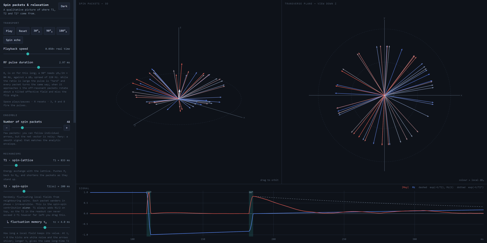
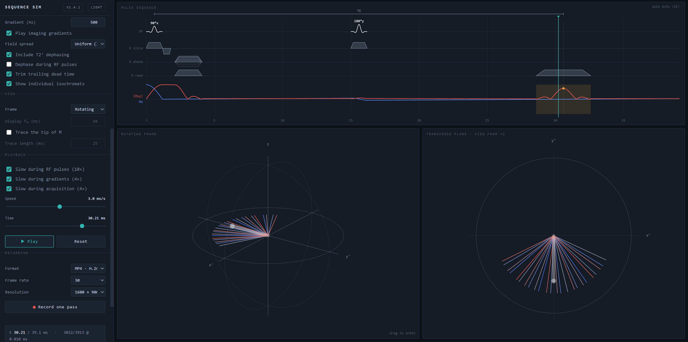
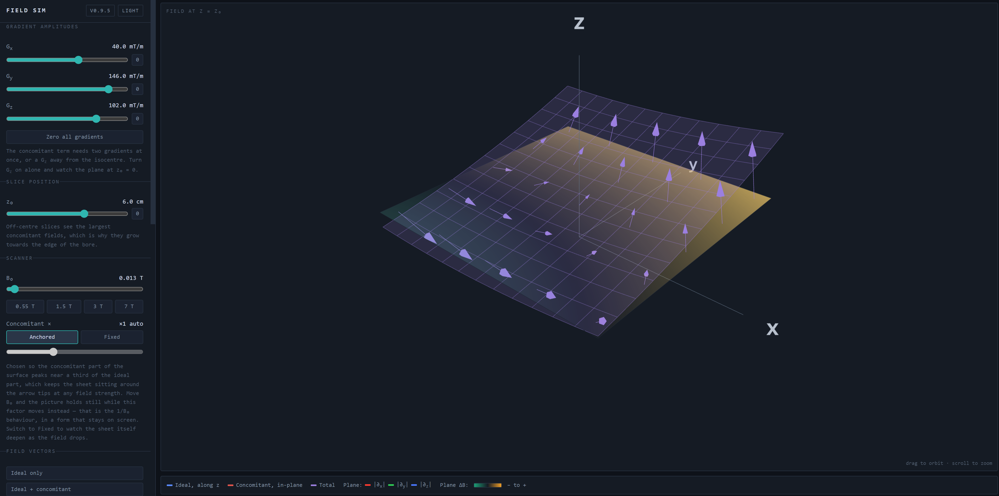
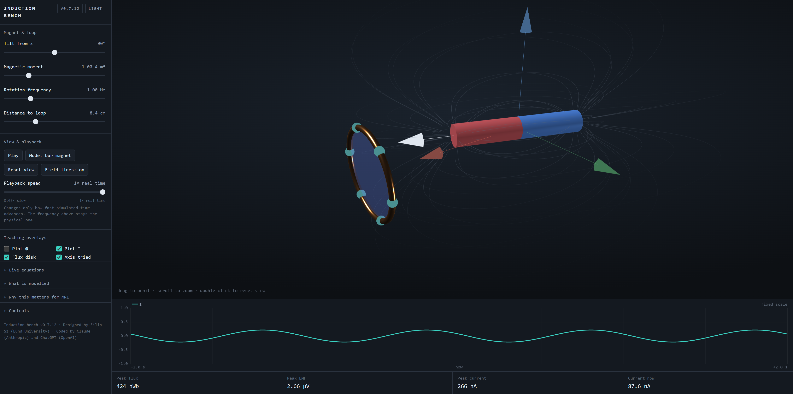
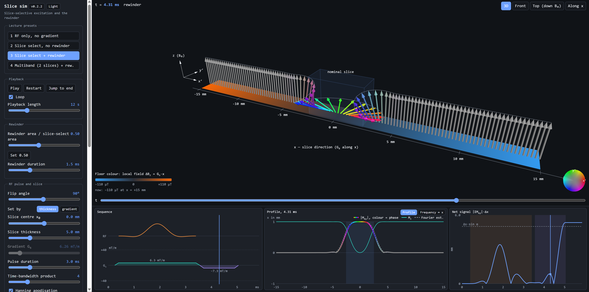
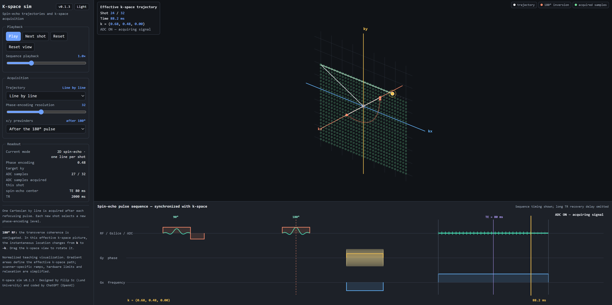
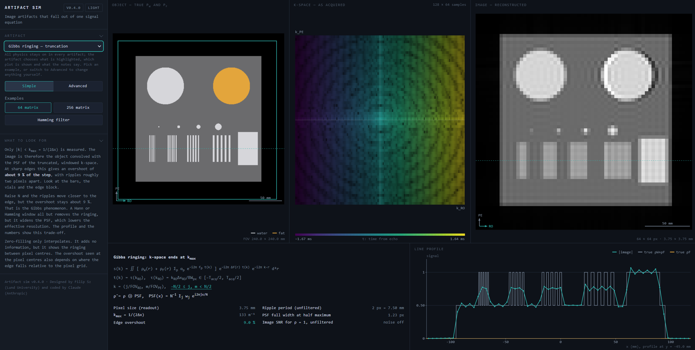
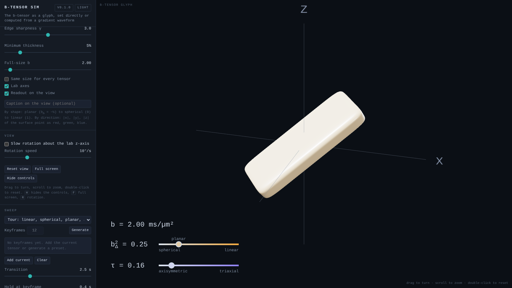

# MRI simulators for visualization
Designed by Filip Sz (Lund University) and coded by Claude (Anthropic) and ChatGPT (OpenAI).

Interactive MRI physics visualisations, each a single self-contained HTML file
that runs offline in a browser. 3D views use WebGL with Three.js bundled in the
file. They should work on PCs and phones, but phones are not tested.

**These are visual teaching aids, not quantitative simulators.** They are meant
for showing ideas and making figures and clips, not for predicting signal. The
models are deliberately simplified. Each simulator lists its simplifications,
credits and changelog under the version chip in its header.

## Simulators

Click a picture or a name to open the specific simulator in the browser directly.

<table>
<tr>
<td width="33%" valign="top">
 
<a href="https://filip-szczepankiewicz.github.io/mriSimGraphical/mriRelaxSim.html"><b>▶ Relaxation sim</b></a> 
T1, T2 and T2* relaxation · <a href="#mrirelaxsimhtml--relaxation-sim">details</a>
</td>
<td width="33%" valign="top">
 
<a href="https://filip-szczepankiewicz.github.io/mriSimGraphical/mriSeqSim.html"><b>▶ Sequence sim</b></a> 
Bloch simulation of common sequences · <a href="#mriseqsimhtml--sequence-sim">details</a>
</td>
<td width="33%" valign="top">
 
<a href="https://filip-szczepankiewicz.github.io/mriSimGraphical/mriFieldSim.html"><b>▶ Field sim</b></a> 
Gradient and concomitant (Maxwell) fields · <a href="#mrifieldsimhtml--field-sim">details</a>
</td>
</tr>
<tr>
<td width="33%" valign="top">
 
<a href="https://filip-szczepankiewicz.github.io/mriSimGraphical/mriInductSim.html"><b>▶ Induction sim</b></a> 
Signal induction in a receive coil · <a href="#mriinductsimhtml--induction-sim">details</a>
</td>
<td width="33%" valign="top">
 
<a href="https://filip-szczepankiewicz.github.io/mriSimGraphical/mriSliceSim.html"><b>▶ Slice sim</b></a> 
Slice-selective excitation and the rewinder · <a href="#mrislicesimhtml--slice-sim">details</a>
</td>
<td width="33%" valign="top">
 
<a href="https://filip-szczepankiewicz.github.io/mriSimGraphical/mriReadoutSim.html"><b>▶ Readout sim</b></a> 
K-space trajectories in spin-echo imaging · <a href="#mrireadoutsimhtml--readout-sim">details</a>
</td>
</tr>
<tr>
<td width="33%" valign="top">
 
<a href="https://filip-szczepankiewicz.github.io/mriSimGraphical/mriArtifactSim.html"><b>▶ Artifact sim</b></a> 
Image artifacts from the signal equation · <a href="#mriartifactsimhtml--artifact-sim">details</a>
</td>
<td width="33%" valign="top">
 
<a href="https://filip-szczepankiewicz.github.io/mriSimGraphical/mriBTensorSim.html"><b>▶ B-tensor sim</b></a> 
b-tensor glyphs from tensors or gradient waveforms · <a href="#mribtensorsimhtml--b-tensor-sim">details</a>
</td>
<td width="33%" valign="top">
 
<a href="https://filip-szczepankiewicz.github.io/mriSimGraphical/mriBuildSim.html"><b>▶ Build sim</b></a> 
Building pulse sequences from RF, gradient and ADC blocks · <a href="#mribuildsimhtml--build-sim">details</a>
</td>
</tr>
</table>

## How to use

**Online:** open the [simulator site](https://filip-szczepankiewicz.github.io/mriSimGraphical/)
and pick a simulator. Each simulator has an *All simulators* link at the top of
its control panel that leads back to the list.

**Offline:** download a simulator and open it in a local browser. Clicking an
`.html` file on GitHub only shows its source.

- **One file:** open the file on GitHub and click *Download raw file* (↓).
- **All files:** **Code → Download ZIP**, or
  `git clone https://github.com/filip-szczepankiewicz/mriSimGraphical.git`

Then double-click the file, or drag it into a browser. A recent Chrome, Edge,
Firefox or Safari is recommended. Video recording uses the WebCodecs API, which
works best in Chrome or Edge. On a phone, save the file and open it in a browser
from the file manager; some file viewers show the source instead.

## `mriRelaxSim.html` — Relaxation sim

**[▶ Open Relaxation sim](https://filip-szczepankiewicz.github.io/mriSimGraphical/mriRelaxSim.html)**

Where T1, T2 and T2\* come from: an isochromat ensemble under T1 relaxation,
spin–spin fluctuations and a static ΔB₀ spread, shown in 3D, in the transverse
plane and as a signal with analytic envelopes. Includes hard or finite RF pulses
and a spin-echo demo.

## `mriSeqSim.html` — Sequence sim

**[▶ Open Sequence sim](https://filip-szczepankiewicz.github.io/mriSimGraphical/mriSeqSim.html)**

Bloch simulation of FID, saturation recovery, spin echo, CPMG, spoiled GRE,
IR-SE and bSSFP, plus a nutation demo. Has a tissue library with two-compartment
mixtures and STIR/FLAIR nulling, slow motion during RF, gradients and
acquisition, and video recording.

## `mriFieldSim.html` — Field sim

**[▶ Open Field sim](https://filip-szczepankiewicz.github.io/mriSimGraphical/mriFieldSim.html)**

3D view of the ideal gradient field and its concomitant (Maxwell) terms, from
the closed-form expression. Gradients up to 200 mT/m, B₀ from 0.01 to 20 T, an
optional ΔB surface, gradient modulation, and orbit or wiggle recordings for
slides.

## `mriInductSim.html` — Induction sim

**[▶ Open Induction sim](https://filip-szczepankiewicz.github.io/mriSimGraphical/mriInductSim.html)**

A precessing magnetic dipole beside a pickup coil: flux, Faraday induction,
induced current, and how they depend on flip angle and distance. It switches
between a classical bar-magnet view and a spin-½ density-operator view. The
spin view shows an exaggerated measurement-probability surface and the live
2×2 density matrix.

## `mriSliceSim.html` — Slice sim

**[▶ Open Slice sim](https://filip-szczepankiewicz.github.io/mriSimGraphical/mriSliceSim.html)**

Slice-selective excitation, and why the rewinder is needed. A sinc RF pulse
plays during a slice-select gradient Gs. The |Mxy|
profile is coloured by phase, so the dispersion before the rewinder and the
coherent slice after it are visible directly. A second panel maps the RF
spectrum onto position, f = γ̄Gsx. Lecture presets step from RF
alone to slice selection with and without a rewinder, then to multiband. The
model is the rotating-frame Bloch equation without relaxation.

## `mriReadoutSim.html` — Readout sim

**[▶ Open Readout sim](https://filip-szczepankiewicz.github.io/mriSimGraphical/mriReadoutSim.html)**

The effective k-space trajectory of a spin-echo acquisition in 3D, synced with
the sequence diagram. The 180° pulse appears as the k → −k mapping, and samples
fill the grid shot by shot. Readouts include line-by-line and multi-echo spin
echo, single-shot and segmented EPI (including propeller blades), and
single-shot and segmented spirals, all at a common adjustable resolution.
Ramps, hardware limits and relaxation are simplified.

## `mriArtifactSim.html` — Artifact sim

**[▶ Open Artifact sim](https://filip-szczepankiewicz.github.io/mriSimGraphical/mriArtifactSim.html)**

Image artifacts as consequences of the signal equation rather than as pictures.
An analytic water/fat phantom is sampled exactly in k-space, each sample at its
own acquisition time, and reconstructed by inverse DFT. Panels show the object,
k-space by acquisition time, the image, and the signal equation with the
responsible term highlighted. Artifacts covered:

- chemical shift of the first and second kind
- aliasing and Gibbs ringing
- susceptibility around a metal or air sphere, displaced along the
  low-bandwidth direction (readout in line-by-line imaging, phase in EPI)
- eddy currents and gradient delay (Nyquist ghost, diffusion distortions)
- pulsatile flow ghosts
- k-space spikes and RF zippers

It covers spin echo, gradient echo and EPI, with four phantoms. A Simple mode
gives worked examples, and an Advanced mode gives full controls. Proton density
only: no relaxation.

## `mriBTensorSim.html` — B-tensor sim

**[▶ Open B-tensor sim](https://filip-szczepankiewicz.github.io/mriSimGraphical/mriBTensorSim.html)**

The b-tensor as a superquadric glyph, coloured by shape or direction. It can be
set by size and shape (b, bΔ, bη) or by eigenvalues and
orientation. It can also be computed from an imported gradient waveform,
B = ∫q(t)q(t)ᵀdt (fwf toolbox conventions). The waveform can then be scaled,
mixed and rotated to show how its changes alter the encoding. Keyframe sweeps
record to H.264 MP4, and stills save as PNG.

## `mriBuildSim.html` — Build sim

**[▶ Open Build sim](https://filip-szczepankiewicz.github.io/mriSimGraphical/mriBuildSim.html)**

Students build a pulse sequence by dragging RF pulses, gradients, a phase
table and ADC events onto rails, and see which components are needed: slice
rewinders, read prephasers, phase encoding. Gradient areas are split at RF
centres and at the nominal echo, so rewinders and prephasers can be designed
by matching numbers. The 3D view shows the slab each pulse acts on (from flip
angle, frequency offset and the slice gradient). A k-space view follows the
trajectory of each coherence pathway, and a simulated image updates with the
sequence. Matrix, FOV and voxel size follow from the dwell time, the read
gradient, the number of phase steps and the phase table's amplitude. Examples
cover gradient echo, spin echo, stimulated echo, double spin echo and
inversion-recovery spin echo. The signal model is an extended-phase-graph style
coherence-pathway calculation with ideal, instantaneous RF and rectangular
slabs; the phantom is taken from Seqret.

## Licence

MIT License (see [`LICENSE`](LICENSE)). See [`NOTICE`](NOTICE.md) for attribution,
AI-assisted development and bundled third-party software.
