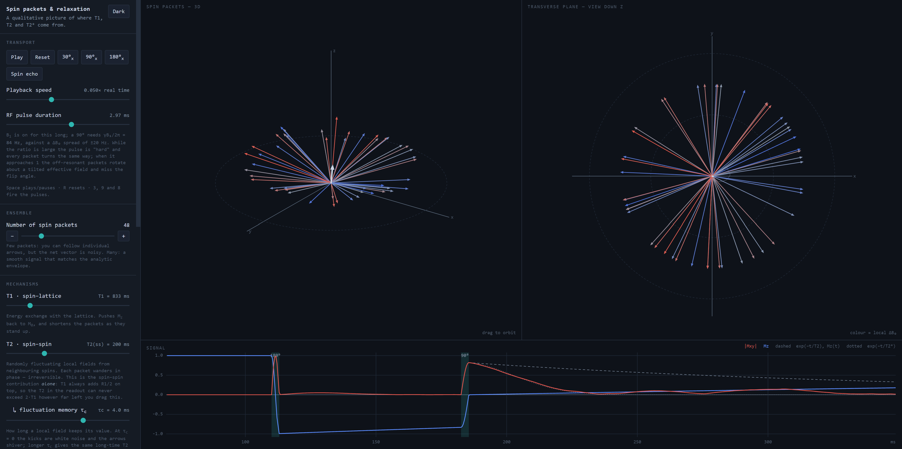
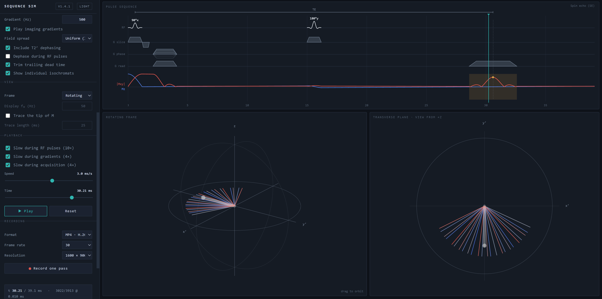
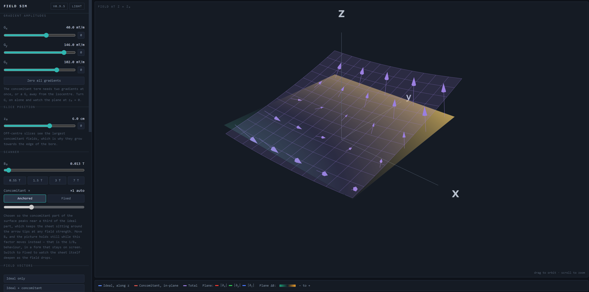
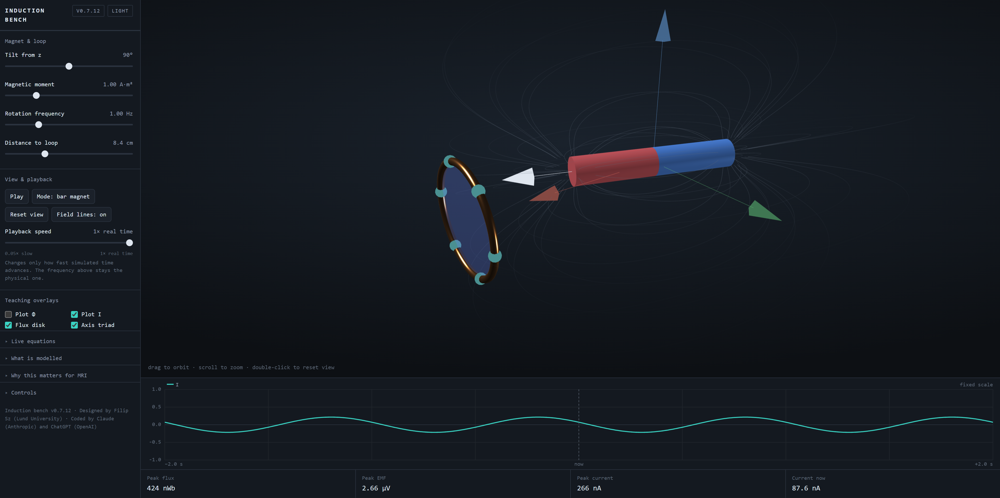
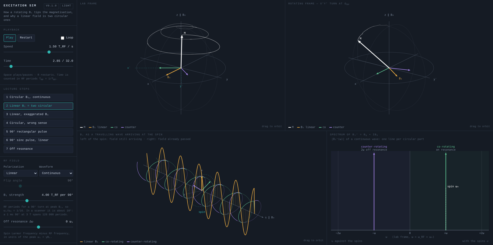
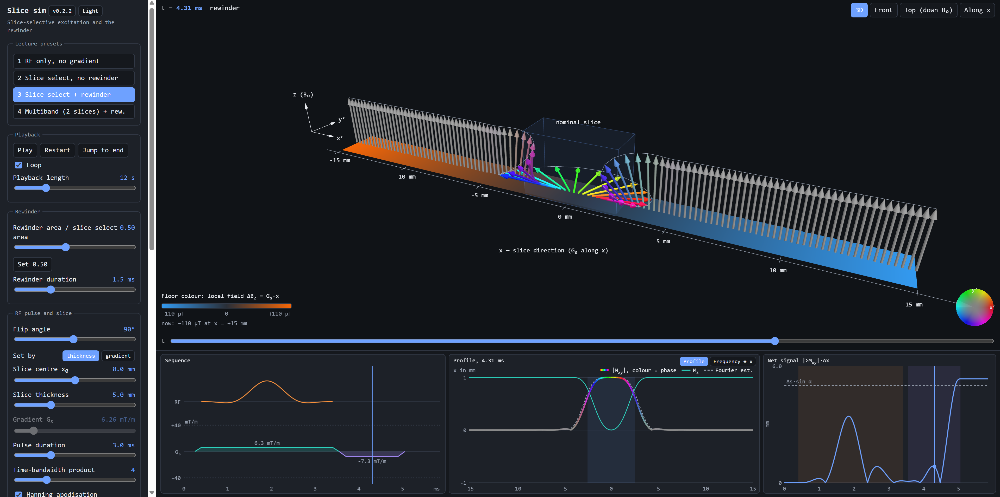
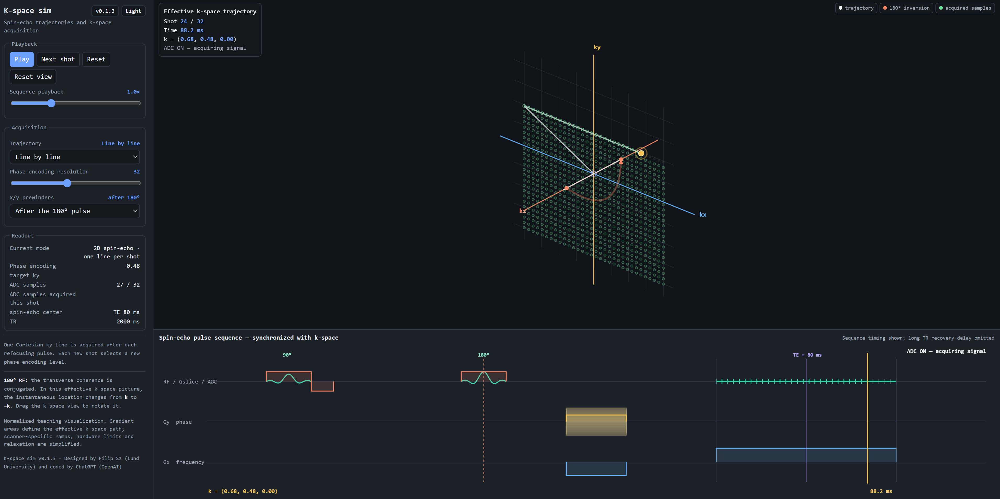
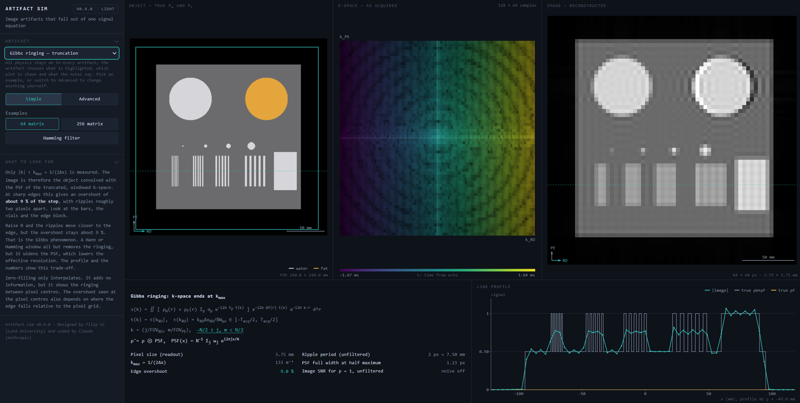
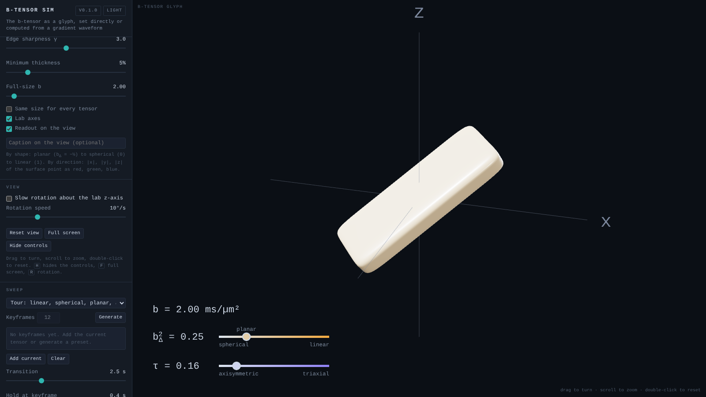

# MRI simulators for visualization
Designed by Filip Sz (Lund University) and coded by Claude (Anthropic) and ChatGPT (OpenAI).

Interactive MRI physics visualisations, each a single self-contained HTML file
that runs offline in a browser. 3D views use WebGL with Three.js bundled in the
file. They should work on PCs and phones, but phones are not tested.

**These are visual teaching aids, not quantitative simulators.** They are meant
for showing ideas and making figures and clips, not for predicting signal. The
models are deliberately simplified. Each simulator lists its simplifications,
credits and changelog under the version chip in its header.

| Simulator | Topic |
|---|---|
| [`mriRelaxSim.html`](#mrirelaxsimhtml--relaxation-sim) | T1, T2 and T2\* relaxation |
| [`mriSeqSim.html`](#mriseqsimhtml--sequence-sim) | Bloch simulation of common sequences |
| [`mriFieldSim.html`](#mrifieldsimhtml--field-sim) | Gradient and concomitant (Maxwell) fields |
| [`mriInductSim.html`](#mriinductsimhtml--induction-sim) | Signal induction in a receive coil |
| [`mriExciteSim.html`](#mriexcitesimhtml--excitation-sim) | RF excitation, circular and linear B₁ |
| [`mriSliceSim.html`](#mrislicesimhtml--slice-sim) | Slice-selective excitation and the rewinder |
| [`mriReadoutSim.html`](#mrireadoutsimhtml--readout-sim) | K-space trajectories in spin-echo imaging |
| [`mriArtifactSim.html`](#mriartifactsimhtml--artifact-sim) | Image artifacts from the signal equation |
| [`mriBTensorSim.html`](#mribtensorsimhtml--b-tensor-sim) | b-tensor glyphs from tensors or gradient waveforms |

## How to use

Download a simulator and open it in a local browser. Clicking an `.html` file
on GitHub only shows its source.

- **One file:** open the file on GitHub and click *Download raw file* (↓).
- **All files:** **Code → Download ZIP**, or
  `git clone https://github.com/filip-szczepankiewicz/mriSimGraphical.git`

Then double-click the file, or drag it into a browser. A recent Chrome, Edge,
Firefox or Safari is recommended. Video recording uses the WebCodecs API, which
works best in Chrome or Edge. On a phone, save the file and open it in a browser
from the file manager; some file viewers show the source instead.

## `mriRelaxSim.html` — Relaxation sim

Where T1, T2 and T2\* come from: an isochromat ensemble under T1 relaxation,
spin–spin fluctuations and a static ΔB₀ spread, shown in 3D, in the transverse
plane and as a signal with analytic envelopes. Includes hard or finite RF pulses
and a spin-echo demo.

## `mriSeqSim.html` — Sequence sim

Bloch simulation of FID, saturation recovery, spin echo, CPMG, spoiled GRE,
IR-SE and bSSFP, plus a nutation demo. Has a tissue library with two-compartment
mixtures and STIR/FLAIR nulling, slow motion during RF, gradients and
acquisition, and video recording.

## `mriFieldSim.html` — Field sim

3D view of the ideal gradient field and its concomitant (Maxwell) terms, from
the closed-form expression. Gradients up to 200 mT/m, B₀ from 0.01 to 20 T, an
optional ΔB surface, gradient modulation, and orbit or wiggle recordings for
slides.

## `mriInductSim.html` — Induction sim

A precessing magnetic dipole beside a pickup coil: flux, Faraday induction,
induced current, and how they depend on flip angle and distance. It switches
between a classical bar-magnet view and a spin-½ density-operator view. The
spin view shows an exaggerated measurement-probability surface and the live
2×2 density matrix.

## `mriExciteSim.html` — Excitation sim

How a rotating B₁ tips the magnetisation, in the lab and rotating frames side by
side. B₁ can be circular (quadrature), linear, or circular but counter-rotating
(turning against the spins), with a sine or square-wave carrier, played as a continuous wave or as a
rectangular, sinc or Gaussian pulse. A
linear field splits into a co-rotating part, which stands still in the rotating
frame and does the tipping, and a counter-rotating part at −2ω, which averages
out. Both are shown in each view, along a travelling-wave picture of the field
and in its spectrum at +ω and −ω. The Bloch equation is solved in the lab frame
without the rotating-wave approximation, so the 2ω wobble and the Bloch–Siegert
shift appear when B₁ is exaggerated. Lecture steps, and MP4 recording of one
pass.

## `mriSliceSim.html` — Slice sim

Slice-selective excitation, and why the rewinder is needed. A sinc RF pulse
plays during a slice-select gradient Gs. The |Mxy|
profile is coloured by phase, so the dispersion before the rewinder and the
coherent slice after it are visible directly. A second panel maps the RF
spectrum onto position, f = γ̄Gsx. Lecture presets step from RF
alone to slice selection with and without a rewinder, then to multiband. The
model is the rotating-frame Bloch equation without relaxation.

## `mriReadoutSim.html` — Readout sim

The effective k-space trajectory of a spin-echo acquisition in 3D, synced with
the sequence diagram. The 180° pulse appears as the k → −k mapping, and samples
fill the grid shot by shot. Readouts include line-by-line and multi-echo spin
echo, single-shot and segmented EPI (including propeller blades), and
single-shot and segmented spirals, all at a common adjustable resolution.
Ramps, hardware limits and relaxation are simplified.

## `mriArtifactSim.html` — Artifact sim

Image artifacts as consequences of the signal equation rather than as pictures.
An analytic water/fat phantom is sampled exactly in k-space, each sample at its
own acquisition time, and reconstructed by inverse DFT. Panels show the object,
k-space by acquisition time, the image, and the signal equation with the
responsible term highlighted. Artifacts covered:

- chemical shift of the first and second kind
- aliasing and Gibbs ringing
- susceptibility around a metal or air sphere, displaced along the
  low-bandwidth direction (readout in line-by-line imaging, phase in EPI)
- eddy currents and gradient delay (Nyquist ghost, diffusion distortions)
- pulsatile flow ghosts
- k-space spikes and RF zippers

It covers spin echo, gradient echo and EPI, with four phantoms. A Simple mode
gives worked examples, and an Advanced mode gives full controls. Proton density
only: no relaxation.

## `mriBTensorSim.html` — B-tensor sim

The b-tensor as a superquadric glyph, coloured by shape or direction. It can be
set by size and shape (b, bΔ, bη) or by eigenvalues and
orientation. It can also be computed from an imported gradient waveform,
B = ∫q(t)q(t)ᵀdt (fwf toolbox conventions). The waveform can then be scaled,
mixed and rotated to show how its changes alter the encoding. Keyframe sweeps
record to H.264 MP4, and stills save as PNG.

## Licence

MIT License (see [`LICENSE`](LICENSE)). See [`NOTICE`](NOTICE) for attribution,
AI-assisted development and bundled third-party software.
